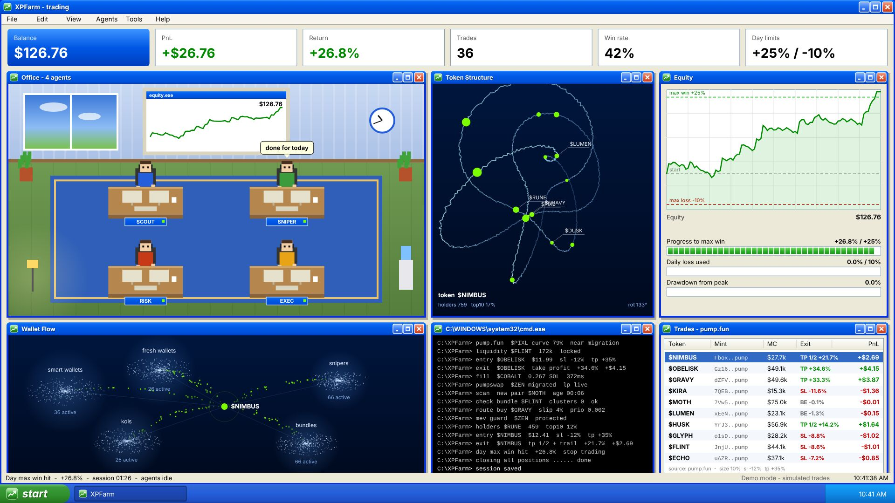
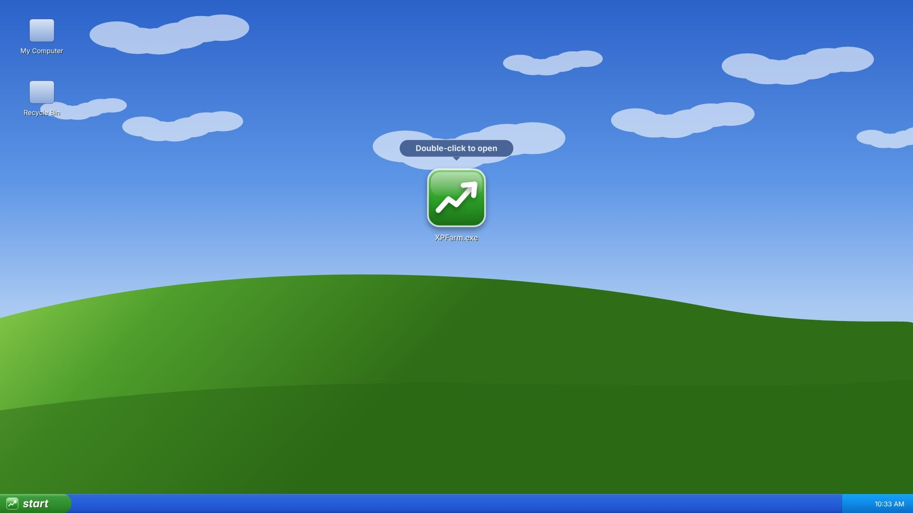
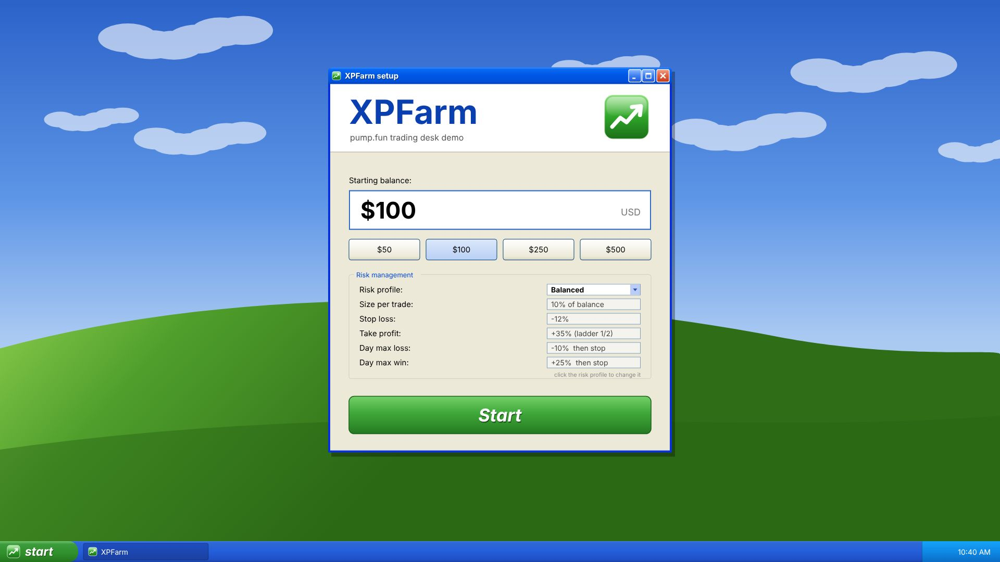
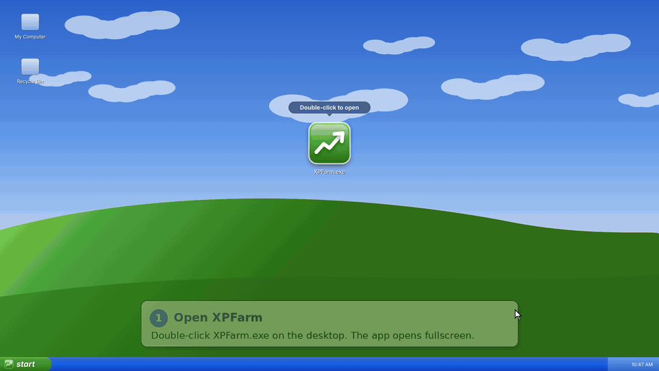
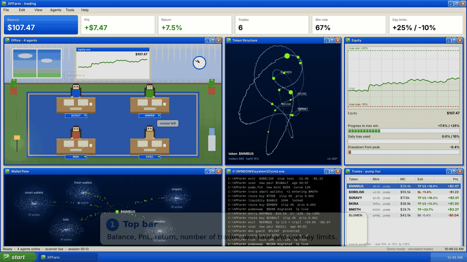
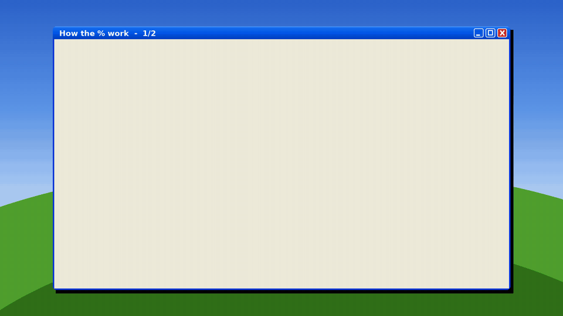
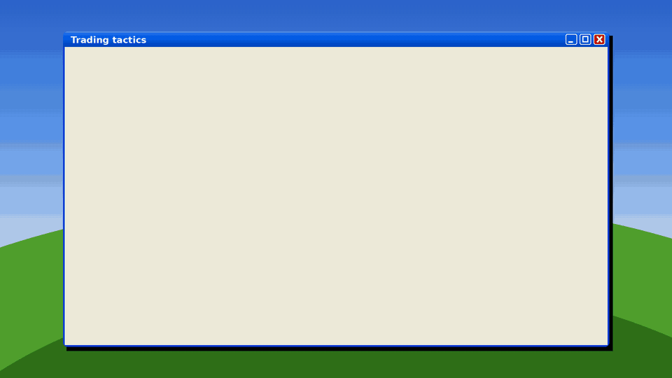

# XPFarm

A Windows XP styled trading-desk **demo**. Pick a starting balance, press Start, and watch four agents (Scout, Sniper, Risk, Exec) work a pump.fun-style session with stop losses, take profits and daily limits.

> **This is a visual simulation.** It does not connect to a wallet, an RPC, pump.fun or any exchange. Every token, mint address, trade and PnL figure is generated randomly in your browser. Nothing here is financial advice or a record of real results.



| Desktop | Setup |
|---|---|
|  |  |

## See it in action

### What it does


### How it works


### How the % work


### Trading tactics


## Run it

No install, no build, no dependencies.

1. Download or clone the repo.
2. Open `index.html` in Chrome, Edge or Firefox.

Or host it for free with GitHub Pages: **Settings → Pages → Deploy from branch → main / root**.

## How to use

1. Click once anywhere to go fullscreen.
2. Double-click **XPFarm.exe** on the desktop.
3. Type a starting balance (or click $50 / $100 / $250 / $500).
4. Press **Start** (or Enter).

Each trade is sized, stopped and closed by the risk profile you pick in setup. The session ends when the day max win or day max loss is hit, or after 50 trades. Most runs finish green, some finish flat or red.

### Risk profiles

Click the **Risk profile** box in setup to switch.

| Profile | Size per trade | Stop loss | Take profit | Day max loss | Day max win |
|---|---|---|---|---|---|
| Conservative | 5% | -8% | +20% | -5% | +10% |
| Balanced (default) | 10% | -12% | +35% | -10% | +25% |
| Aggressive | 20% | -20% | +60% | -20% | +50% |

Exits: **TP** full take profit, **TP 1/2** half taken at target then trailed, **BE** breakeven scratch, **SL** stop loss (can slip a little past the stop, like a real fill).

### Keys

| Key | Action |
|---|---|
| Enter | Open the app / start the session |
| 0-9, Backspace | Edit the starting balance |
| R | Back to setup for a new run |
| F | Re-enter fullscreen |
| Esc | Exit fullscreen |

### Options

Pick the profile from the URL:

```
index.html?risk=conservative
index.html?risk=balanced
index.html?risk=aggressive
index.html?seed=31        replay the same session every time
```

## Panels

- **Office**: four pixel agents at their desks, with live status bubbles and an equity screen on the wall.
- **Token Structure**: a rotating 3D graph of the current token's holders.
- **Equity**: balance chart with the day max win / max loss lines, plus progress, daily-loss and drawdown meters.
- **Wallet Flow**: smart wallets, fresh wallets, snipers, KOLs and bundles flowing into the current token.
- **cmd.exe**: the agents' log (scans, bundle checks, fills, exits, migrations).
- **Trades - pump.fun**: token, mint (`....pump`), market cap, exit type (TP / TP 1/2 / BE / SL) and PnL for every trade.

## Tech

One self-contained `index.html`: vanilla JavaScript on a single `<canvas>`, drawn at 1920x1080 and scaled to any screen. No frameworks, no network requests.

## License

MIT, see [LICENSE](LICENSE). Windows XP is a trademark of Microsoft; this project is not affiliated with or endorsed by Microsoft or pump.fun.
